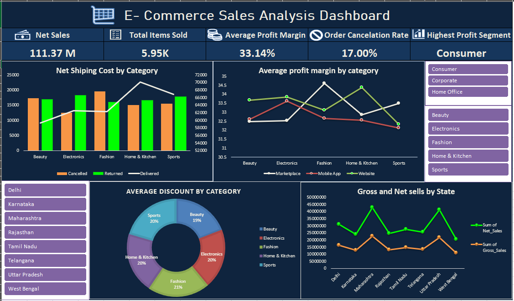

# E Commerce Business Intelligence Platform

We used Excel, Python (Matplotlib), and Power BI to explore the same e-commerce dataset from January 2024 to December 2025. The project covers 2,000 orders from 492 distinct customers across four areas: sales, customers, products, and profitability.

## Power BI Dashboard Preview

## Matplotlib Dashboard Preview

## Excel Dashboard Preview

## Explore the project

| Version | What you can explore |
|---|---|
| [Excel](./Excel/) | Four dashboards cover sales, customers, products, and profitability. The final dashboard brings them together. |
| [Matplotlib](./Python%20Matplotlib/) | A single dashboard with 11 charts shows monthly sales and profit, top products, order status, and margins by sales channel. |
| [Power BI](./Power%20BI/) | The Home page gives an overview. Four interactive pages let you explore each area using filters and rankings. The Insights page explains the figures and highlights key findings. |

## Reading the sales figures

The Matplotlib dashboard shows ₹111.37 million in recorded net sales across all order statuses. The Power BI Delivered Sales card shows ₹72.27 million for delivered orders only. The order status filter explains the difference.

## Key Findings

- Maharashtra led all states with ₹20.3 million in recorded net sales, followed by Uttar Pradesh at ₹19.4 million.
- The Consumer segment accounted for 1,187 of 2,000 orders (59.4%).
- Of all orders, 65.7% were delivered, 17.5% were returned, and 16.8% were cancelled.
